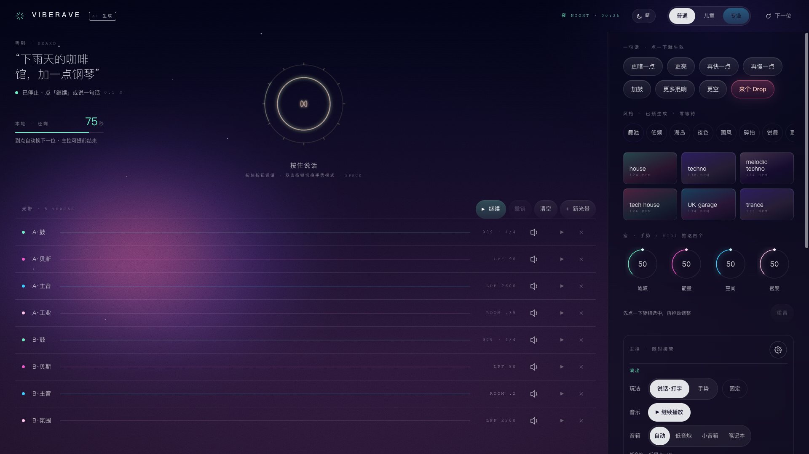
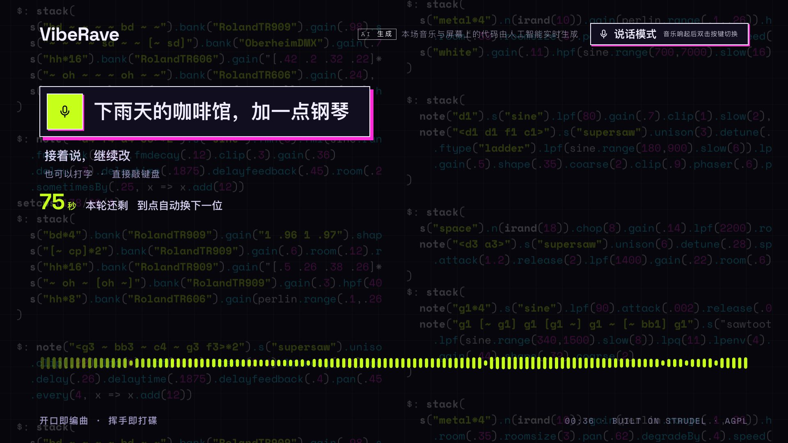

# VibeRave

[](README.md)
[](README.en.md)

**From Vibe Coding to Vibe Raving: make electronic music with one sentence.**

Say a sentence, type a line, or gesture at a camera, and an AI writes [Strudel](https://strudel.cc) code and plays it live. A big screen shows the code that is playing. It is an interactive music booth, built on Strudel.





## How to play

- **Speak or type**: "some deep house", "a rainy-day café, add a little piano", "heavier drums". The first sentence makes a track; every sentence after that changes the track that is playing. The booth's built-in phrases and style names are in Chinese; free-form requests go to the AI and work in English too.
- **Gestures**: raise a hand to open the filter, pull both hands apart for more energy, hold a fist for a drop, wave left and right four times to change style. Cross both hands to stop everything. ✌️, ☝️ and 🤘 ask the AI to add a melody, vary the track, or make the bass heavier; 🤙 (only the little finger out) adds reverb and 👎 thins the track out.
- **Big screen**: shows the code being played, the BPM, the AI's note on what it changed, and a waveform. It goes back to its idle screen when nobody is playing.
- **Console**: staff switch the play mode, set each visitor's turn length, pause the music and adjust the big screen.

## Quick start

You need macOS or Linux, Node.js 22+, pnpm 10 and Google Chrome.

```bash
pnpm install
# the two native modules for local speech recognition (pnpm may skip their install scripts; needs Xcode command line tools on macOS)
# the vosk step downloads from GitHub and must succeed, or the API will not start; it can be slow
pnpm rebuild smart-whisper
(cd node_modules/.pnpm/vosk-koffi@*/node_modules/vosk-koffi && node scripts/postinstall.js)
cp .env.example .env              # add your AI API keys, see below

cd website
npm run booth:assets              # hand-tracking model and fonts
npm run booth:sounds              # sounds (the third-party sound libraries are about 1.9 GB)
cd ..
# default local speech model (about 574 MB). Skip it if you only use cloud speech, but then nothing catches a cloud failure
mkdir -p ~/.smart-whisper/models
curl -fL -o ~/.smart-whisper/models/large-v3-turbo-q5_0.bin https://huggingface.co/ggerganov/whisper.cpp/resolve/main/ggml-large-v3-turbo-q5_0.bin
node services/api/scripts/build-library.mjs --mode all   # pre-built library (the fallback when no AI is reachable)
npm run jsdoc-json                # generates doc.json, needed by the web build

# terminal 1: API (port 4322)
cd services/api && node --env-file=../../.env src/index.mjs

# terminal 2: web pages (port 4321)
cd website && npx astro build && npx astro preview --port 4321 --host 0.0.0.0
```

Open in Chrome:

- Console: <http://localhost:4321/booth?room=main> (the sound comes from this page)
- Big screen: <http://localhost:4321/stage?room=main> (the gesture camera runs on this page too)

Both pages must use the same `room`. To have sound start without a click, launch Chrome with `--autoplay-policy=no-user-gesture-required`.

## Configuration

Everything is in `.env`; `.env.example` explains each setting.

- **Music AI**: any OpenAI-compatible API works. The default order is DeepSeek (`LLM_DEEPSEEK_API_KEY`), then DeepSeek on Alibaba Cloud Bailian (`LLM_DASHSCOPE_API_KEY`). A local Ollama works too, with no key. When no AI is reachable, the booth plays the pre-built library.
- **Speech recognition**: Qwen `qwen3-asr-flash` first (same Bailian key), then local Whisper (see the model step in Quick start).
- While the services run, long-press "⚙ 设置" (Settings) on the console for 1.5 s to change keys and the AI order without a restart. That panel only answers the booth computer itself.

## Layout

| Path | What |
| --- | --- |
| `website/src/booth/` | console, big screen, gestures, audience page |
| `services/api/` | API: AI generation and validation, speech recognition, room sync, library (see its README) |
| `services/api/library/` | pre-written library tracks (made with AI assistance) |
| `packages/` | Strudel's audio and pattern engine (some files modified) |

The "CONTRACTS §" numbers in code comments refer to an internal design document that is not part of this release.

## Disclaimer

- This software is provided "as is", without warranty of any kind, express or implied; you use it at your own risk (see [LICENSE](LICENSE), sections 15 and 16).
- This is not an official Strudel project and is not affiliated with or endorsed by Strudel or its authors.
- Music and code are generated live by third-party AI models and may be inaccurate or inappropriate; please review them yourself. The authors are not responsible for generated content.
- Third-party AI and speech services need your own API keys and are used under their own terms and pricing. If you record sound or camera images in public, follow local law and tell participants.
- Third-party sounds, models and fonts are used under their own licences; see [NOTICE.md](NOTICE.md).

## Licence

[AGPL-3.0-or-later](LICENSE). This project is a modified version of [Strudel](https://codeberg.org/uzu/strudel) (© Strudel contributors); see [NOTICE.md](NOTICE.md). If you run a modified version over a network, you must offer its users your source code (AGPL §13).
