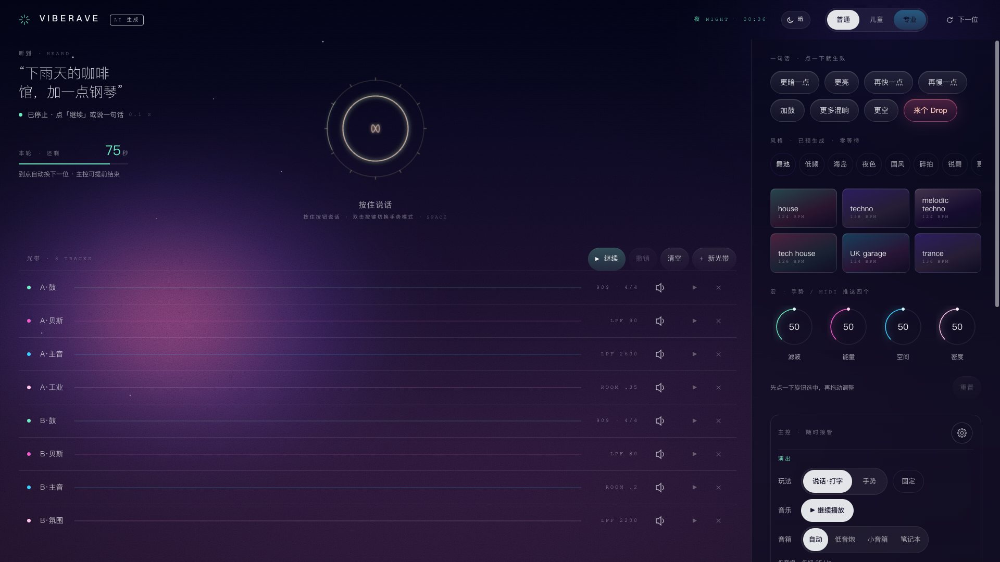
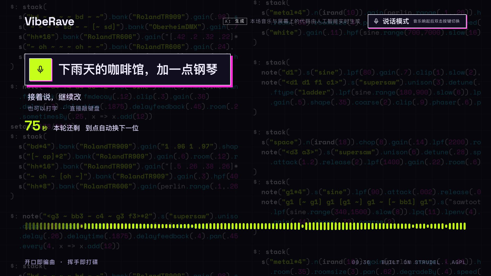

# VibeRave

[](README.md)
[](README.en.md)

**从 Vibe Coding 到 Vibe Raving：一句话玩转电子乐。**

说一句话、打一行字，或者对着摄像头做个手势，AI 就会实时写出 [Strudel](https://strudel.cc) 代码并演奏出来。大屏同步显示正在演奏的代码。这是一个互动音乐展台，基于 Strudel 开发。





## 玩法

- **说话或打字**：「来点 deep house」「下雨天的咖啡馆，加一点钢琴」「鼓再重一点」。第一句生成一首曲子，之后每一句都在当前曲子上修改。
- **手势**：举手打开滤波，双手拉开加能量，握拳来个 drop，左右挥手四下换风格。双手打叉全部停。比耶、竖食指、摇滚手分别交给 AI 加旋律、来点变化、加重低音，比六（只伸小拇指）加混响，拇指朝下让曲子更空。
- **大屏**：实时显示正在演奏的代码、BPM、AI 的改动说明和波形；没人时自动回到待机画面。
- **中控台**：工作人员可以切换玩法、设置每人的回合时长、暂停音乐、调整大屏。

## 快速开始

需要 macOS 或 Linux、Node.js 22 以上、pnpm 10、Google Chrome。

```bash
pnpm install
# 本地语音识别的两个原生模块（pnpm 可能跳过它们的安装脚本，需要 Xcode 命令行工具）。
# vosk 这一步要从 GitHub 下载，必须成功，否则后端启动不了；网络慢时可能要等一阵。
pnpm rebuild smart-whisper
(cd node_modules/.pnpm/vosk-koffi@*/node_modules/vosk-koffi && node scripts/postinstall.js)
cp .env.example .env              # 填入 AI 的 API key，见下文

cd website
npm run booth:assets              # 手势模型和字体
npm run booth:sounds              # 音色（第三方音色库约 1.9 GB）
cd ..
# 本机语音识别的默认模型（约 574 MB）。只用云端语音识别可以跳过，但云端失败时就没有兜底了
mkdir -p ~/.smart-whisper/models
curl -fL -o ~/.smart-whisper/models/large-v3-turbo-q5_0.bin https://huggingface.co/ggerganov/whisper.cpp/resolve/main/ggml-large-v3-turbo-q5_0.bin
node services/api/scripts/build-library.mjs --mode all   # 预生成曲库（AI 不可用时的兜底）
npm run jsdoc-json                # 生成 doc.json，网页构建要用

# 终端 1：后端（端口 4322）
cd services/api && node --env-file=../../.env src/index.mjs

# 终端 2：网页（端口 4321）
cd website && npx astro build && npx astro preview --port 4321 --host 0.0.0.0
```

用 Chrome 打开：

- 中控台：<http://localhost:4321/booth?room=main>（声音从这一页发出）
- 大屏：<http://localhost:4321/stage?room=main>（手势摄像头也在这一页）

两个页面的 `room` 要一致。要让页面打开就自动出声，可以给 Chrome 加启动参数 `--autoplay-policy=no-user-gesture-required`。

## 配置

所有设置都在 `.env` 里，`.env.example` 有逐项说明。

- **生成音乐的 AI**：任何 OpenAI 兼容的接口都可以。默认顺序是 DeepSeek（`LLM_DEEPSEEK_API_KEY`），然后是阿里云百炼上的 DeepSeek（`LLM_DASHSCOPE_API_KEY`）。也可以用本地的 Ollama，不需要 key。所有 AI 都不可用时，会自动播放预生成曲库。
- **语音识别**：默认先用千问 `qwen3-asr-flash`（同一把百炼 key），再退回本机 Whisper（模型见「快速开始」）。
- 服务运行时，中控台长按「⚙ 设置」1.5 秒，可以修改 key 和 AI 顺序，不用重启。这个面板只对本机开放。

## 目录

| 路径 | 内容 |
| --- | --- |
| `website/src/booth/` | 中控台、大屏、手势、观众页 |
| `services/api/` | 后端：AI 生成与校验、语音识别、房间同步、曲库（见其 README） |
| `services/api/library/` | 预先写好的曲库作品（AI 辅助创作） |
| `packages/` | Strudel 的音频与模式引擎（部分有修改） |

代码注释里的「CONTRACTS §」编号指向内部设计文档，这份文档没有随开源版本发布。

## 免责声明

- 本软件按「现状」提供，不附带任何明示或默示的担保，使用风险由使用者自行承担（见 [LICENSE](LICENSE) 第 15、16 条）。
- 本项目不是 Strudel 官方项目，和 Strudel 及其作者没有隶属或背书关系。
- 音乐和代码由第三方 AI 实时生成，可能不准确或不合适，请使用者自行把关。本项目的作者不对生成的内容负责。
- 使用第三方 AI 或语音识别服务需要自备 API key，并遵守相应服务的条款和收费规则。在公开场合采集声音或摄像头画面，请遵守当地法律并告知参与者。
- 第三方音色、模型和字体按各自的许可证使用，详见 [NOTICE.md](NOTICE.md)。

## 许可证

[AGPL-3.0-or-later](LICENSE)。本项目是 [Strudel](https://codeberg.org/uzu/strudel)（© Strudel contributors）的修改版本，详见 [NOTICE.md](NOTICE.md)。如果你在网络上运行修改后的版本，需要向使用者提供你的源码（AGPL §13）。
